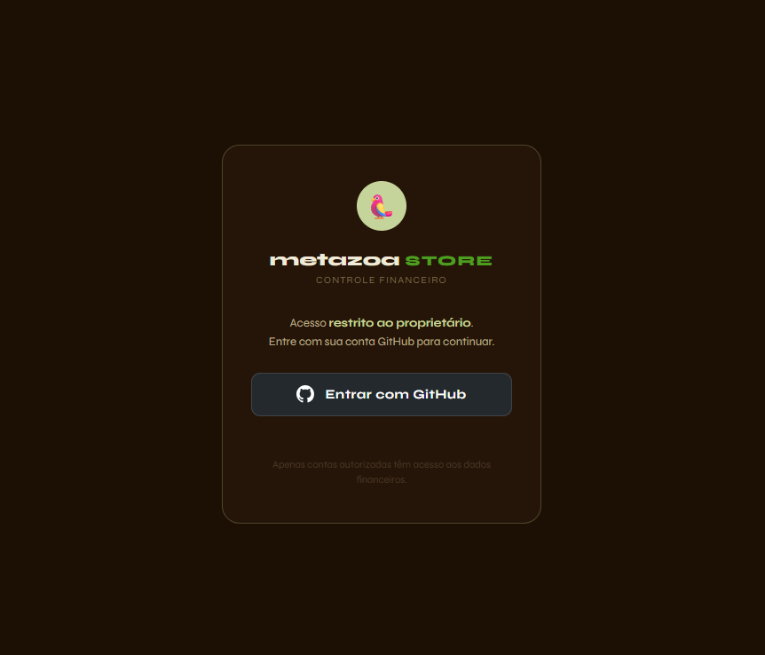
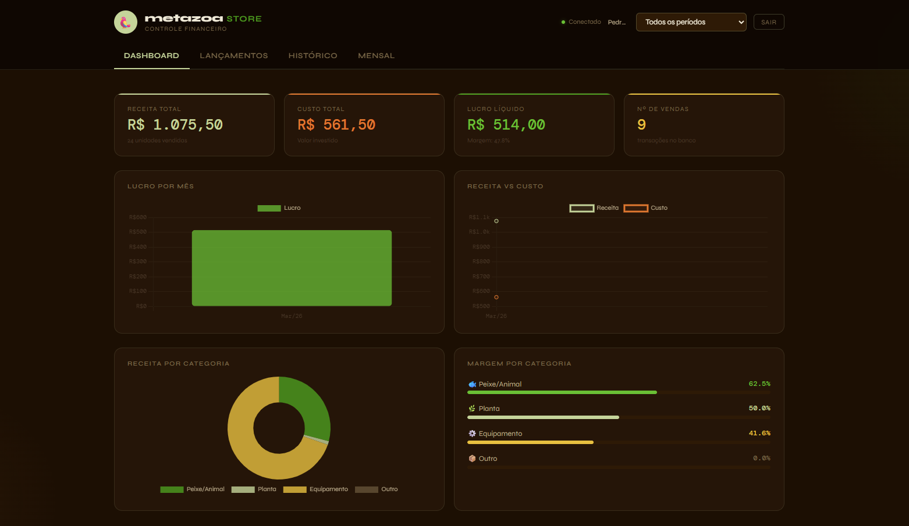

# 🦜 Metazoa Store — Gestão Financeira e Operacional

Sistema de gestão desenvolvido para a operação diária da [Metazoa Store](https://metazoastore.vercel.app/#/), loja de aquarismo e animais ornamentais. Centraliza vendas, despesas, pedidos, envios e clientes, com KPIs de lucro real em tempo real — e pode ser instalado no celular como aplicativo (PWA).

🔗 **[Acessar o sistema](https://metazoa-financas.vercel.app)** *(acesso restrito ao proprietário)*

---

## 📸 Preview

| Login | Dashboard |
|---|---|
|  |  |

---

## ✨ Funcionalidades

### 📊 Dashboard
- KPIs do mês: receita, custo, lucro, margem, **despesas do mês** e **lucro real**
- **Lucro real** = lucro líquido dos produtos + lucro de frete − descontos − despesas do mês
- Gráficos (Chart.js): lucro mensal, receita vs custo, vendas por categoria e despesas por categoria
- Metas mensais de receita
- **Painel de insights** — produto mais lucrativo (margem % combinada com unidades vendidas) e melhor cliente (frequência combinada com valor gasto)
- Alerta quando há pedidos prontos para avisar o cliente
- **Calendário & Tarefas** — calendário mensal com marcação dos dias com tarefas
- **Bloco de notas** — notas adesivas coloridas, editáveis inline

### 🧾 Lançamentos e Histórico
- Venda **multi-item** em carrinho, com frete cobrado, custo real do frete, desconto e comentários
- **Autocomplete** de produtos (preenche o último custo/preço usado) e de clientes (mostra o histórico de compras)
- Histórico agrupado **por mês, como extrato bancário**, com subtotal de vendas, receita e lucro em cada mês; cada venda abre em acordeão com seus itens

### 💸 Despesas
- Registro de despesas e investimentos por categoria (anúncios, equipamentos, ração, medicamentos, logística, contas fixas, outros), com marcação de recorrência

### 📋 Pedidos (lista de espera)
- **Kanban** com 4 colunas: Aguardando → Disponível → Notificado → Concluído
- Prioridade, filtro por categoria e badge com a contagem de pendentes na aba
- Ação **"Concluir → Venda"**, que preenche o formulário de lançamento a partir do pedido

### 📦 Envios
- Fila de envios pendentes (cliente, transportadora, itens), registrada antes do preço final
- Checklist de itens preparados com contador de progresso e KPIs de custo/lucro
- **"Transferir p/ Lançamentos"** carrega o envio direto no carrinho de venda
- Itens e cabeçalho editáveis depois de criados, e histórico de envios

### 👥 Clientes
- Base de clientes com telefone e observações
- **Alertas de recontato** com limite configurável de dias desde a última compra
- Contagem de pedidos em aberto por cliente

### 📱 PWA e mobile
- Instalável na tela inicial do iPhone/Android, em tela cheia
- Service worker com cache *stale-while-revalidate* do app shell
- Layout mobile revisado: abas com scroll horizontal, cards empilhados, botões com área de toque maior

---

## 🛠️ Tecnologias

| Tecnologia | Uso |
|---|---|
| HTML, CSS, JavaScript | Frontend single-page |
| Supabase | PostgreSQL + Auth |
| Chart.js | Gráficos |
| Service Worker + Web App Manifest | PWA instalável |
| GitHub OAuth | Autenticação |
| Vercel | Deploy e hospedagem |

---

## 🔐 Segurança

- Login obrigatório via **GitHub OAuth**
- **Row Level Security (RLS) owner-only em todas as tabelas** — só o usuário proprietário lê e escreve dados; nenhuma outra conta autenticada tem acesso
- A chave usada no frontend é a chave pública (anon) do Supabase, projetada para ficar exposta; a proteção real está nas políticas RLS

---

## 🗄️ Banco de Dados (Supabase)

| Tabela | Conteúdo |
|---|---|
| `transactions` | Itens de venda (produto, categoria, quantidade, custo, preço, data) |
| `sales` | Dados por venda: frete cobrado, custo do frete, desconto, comentários |
| `expenses` | Despesas e investimentos por categoria |
| `pedidos_espera` | Lista de espera / pedidos (kanban) |
| `envios` / `envio_itens` | Fila de envios e seus itens |
| `clientes` | Telefone e observações por cliente |
| `tarefas` | Tarefas do calendário |
| `notas_adesivas` | Bloco de notas do dashboard |

Todas as tabelas usam a mesma política *owner-only*:

```sql
ALTER TABLE nome_da_tabela ENABLE ROW LEVEL SECURITY;

CREATE POLICY "owner_only" ON nome_da_tabela
  FOR ALL USING (auth.uid() = 'SEU-UUID-AQUI')
  WITH CHECK (auth.uid() = 'SEU-UUID-AQUI');
```

---

## 📁 Estrutura

```
metazoa-financas/
├── index.html               # Aplicação completa (single-file)
├── manifest.json            # Manifesto do PWA
├── sw.js                    # Service worker
├── icon-192.png / icon-512.png / icon-maskable-512.png / apple-touch-icon.png
└── screenshot-*.png         # Imagens do README
```

---

## 🚀 Como rodar localmente

```bash
git clone https://github.com/PedroMSBarros/Metazoa-financas.git
```

Abra o `index.html` no navegador.

> ⚠️ O login com GitHub redireciona para o Supabase. Para funcionar localmente, adicione `http://localhost` nas Redirect URLs do seu projeto Supabase.

---

## 👨‍💻 Autor

**Pedro Barros** — [@PedroMSBarros](https://github.com/PedroMSBarros)

Estudante de Defesa Cibernética (Impacta) | Fundador da Metazoa Store

Desenvolvido para uso interno da Metazoa Store 🐠
